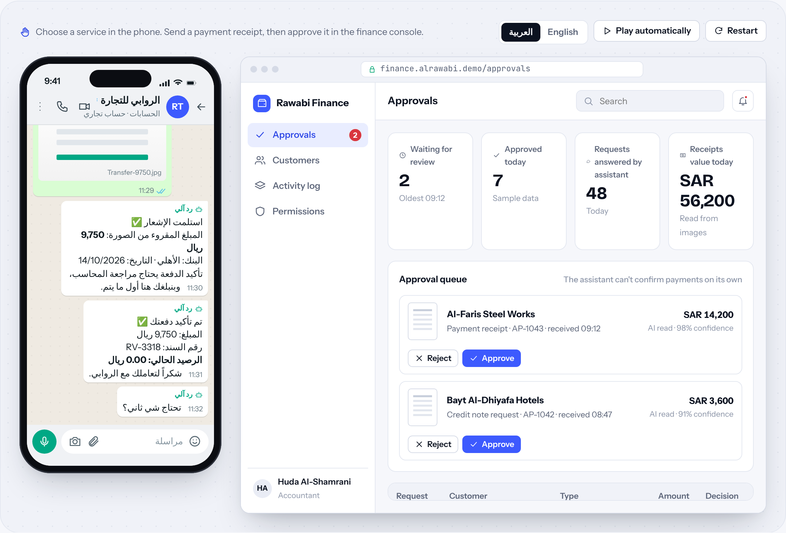
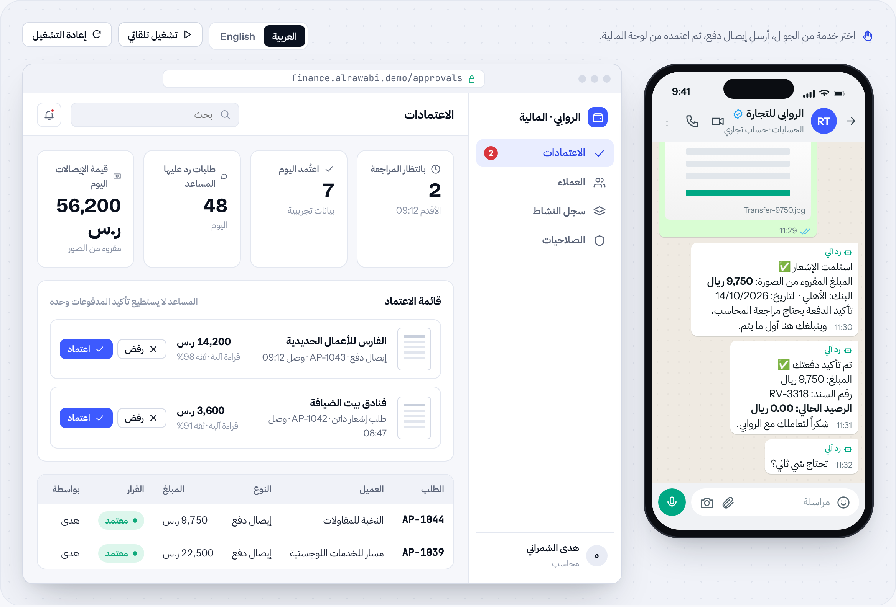

# Hesabo

**WhatsApp finance assistant** · WhatsApp & AI assistants · by [HUDERA AI](https://www.linkedin.com/company/hudera)

Customers request statements, invoice copies and payment confirmations on WhatsApp. The assistant answers from your accounting system; accountants approve anything sensitive.

**[▶ Try the live demo](https://hudera-ai.github.io/hesabo/)** · runs in your browser on sample data · Arabic & English

## The problem
Accountants spend hours answering the same balance and invoice questions, and payment receipts arrive as photos in personal chats that are easy to miss.

## What it does
A WhatsApp assistant connected to your existing accounting system. It verifies the customer's number, sends statements and invoice copies, reads payment receipts from photos, and queues confirmations for an accountant's approval.

## Business value
Routine requests are answered at once. Accountants review only what needs judgment, and every action is logged.

## Features
| Feature | Details |
| --- | --- |
| Verified numbers | Only registered contacts get account data |
| Statements & invoices | PDFs generated from your ledger |
| Receipt reading | Amount, bank and date read from photos |
| Approval queue | Nothing is confirmed without a person |
| Permissions | Choose what the assistant may do alone |
| Audit log | Every request and decision recorded |

## How the workflow runs
**Trigger**: Customer request → **Verify**: Match the number → **Answer**: Statement / invoice → **Review**: Receipt to approval → **Close**: Confirmation sent

## Typical stack
WhatsApp Business Platform · Accounting system API · Document OCR · n8n · Web console

## Run it locally
Open `index.html` in any modern browser. No build step, no server, no data leaves your machine.

---

## Hesabo بالعربي

**مساعد مالي على واتساب**

العملاء يطلبون كشوف الحساب ونسخ الفواتير وتأكيد المدفوعات عبر واتساب. المساعد يرد من نظامك المحاسبي، والمحاسب يعتمد أي أمر حساس.

### المشكلة
المحاسبون يقضون ساعات في الرد على نفس أسئلة الأرصدة والفواتير، وإيصالات الدفع تصل صوراً في محادثات شخصية يسهل أن تضيع.

### ما الذي يفعله
مساعد واتساب مربوط بنظامك المحاسبي الحالي. يتحقق من رقم العميل، ويرسل كشوف الحساب ونسخ الفواتير، ويقرأ إيصالات الدفع من الصور، ويضع التأكيدات في قائمة اعتماد المحاسب.

### القيمة للأعمال
الطلبات الروتينية يُرد عليها فوراً. المحاسب يراجع فقط ما يحتاج تقديراً، وكل إجراء مسجَّل.

### المزايا
| الميزة | التفاصيل |
| --- | --- |
| أرقام موثّقة | بيانات الحساب تُرسل فقط للأرقام المسجلة |
| كشوف الحساب والفواتير | ملفات PDF من دفتر الأستاذ لديك |
| قراءة الإيصالات | المبلغ والبنك والتاريخ تُقرأ من الصور |
| قائمة الاعتماد | لا يُؤكَّد شيء دون موافقة شخص |
| الصلاحيات | حدّد ما يمكن للمساعد فعله وحده |
| سجل التدقيق | كل طلب وقرار مسجَّل |

### كيف يسير العمل
**المُشغِّل**: طلب العميل ← **Verify**: مطابقة الرقم ← **Answer**: كشف حساب / فاتورة ← **المراجعة**: الإيصال إلى الاعتماد ← **إغلاق**: إرسال التأكيد

---

## About HUDERA AI
HUDERA AI builds WhatsApp AI assistants, business dashboards, workflow automations and custom SaaS products for companies in Saudi Arabia and the Gulf.

- LinkedIn: [linkedin.com/company/hudera](https://www.linkedin.com/company/hudera)
- Email: hudera.ai@gmail.com
- WhatsApp: [+20 155 515 9139](https://wa.me/201555159139)

> This repository is a product demo. Company names, people and figures inside it are fictional sample data.

© 2026 HUDERA AI. All rights reserved.
